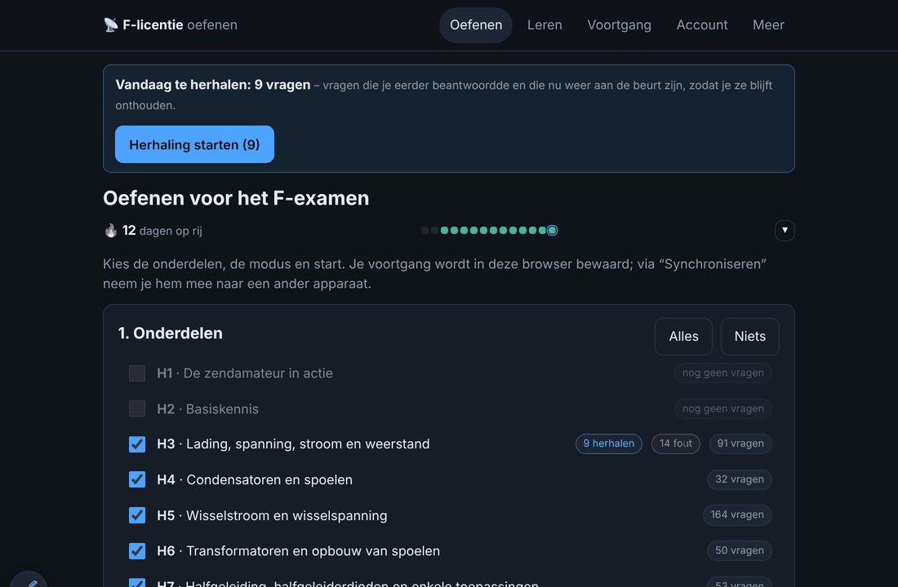
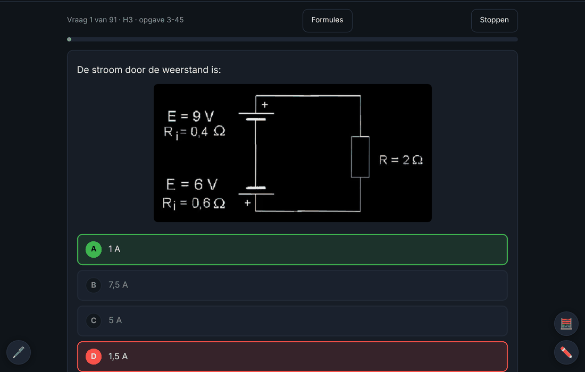
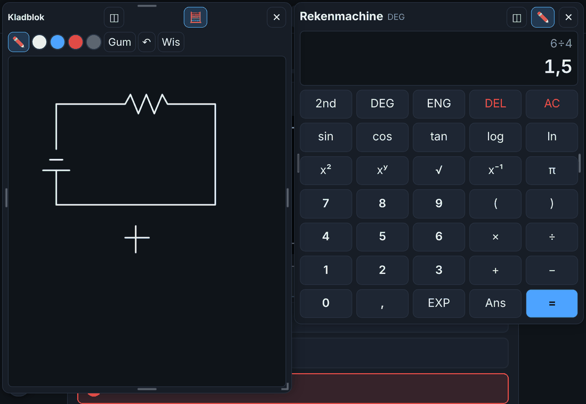
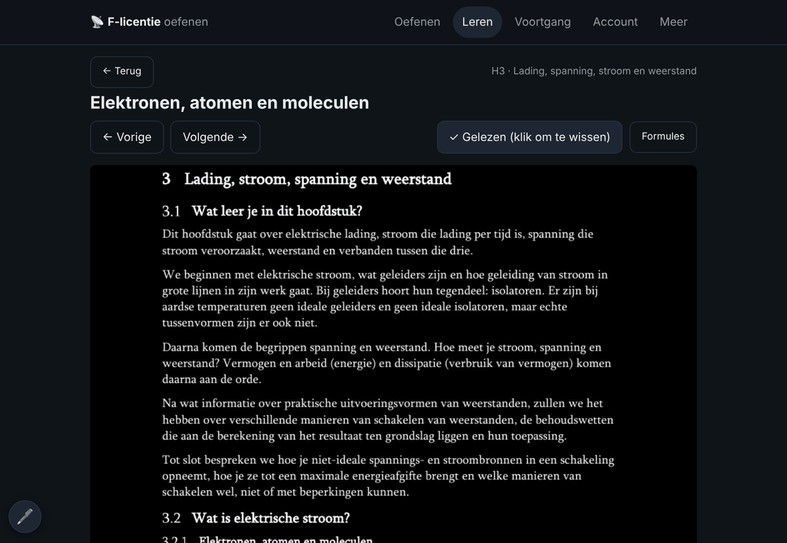
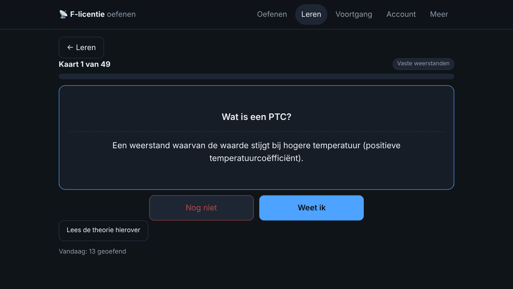
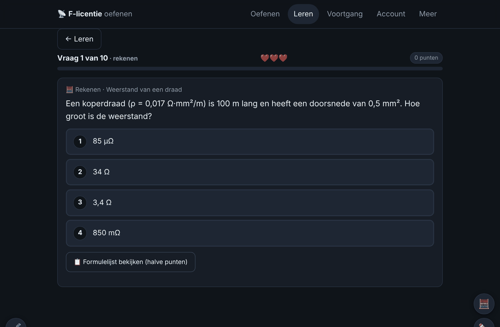
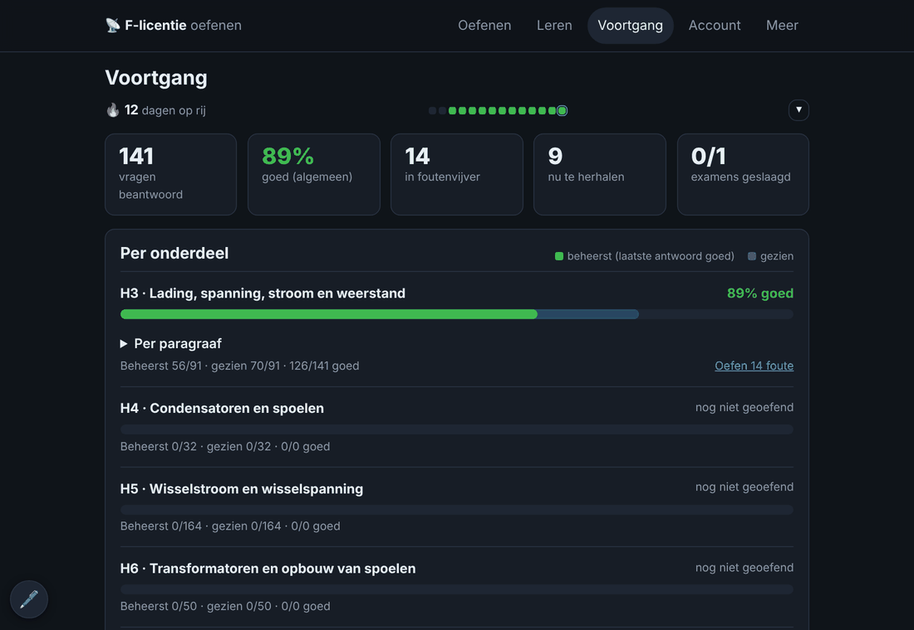

# F-licentie oefenen 📡

Oefenapp voor het Nederlandse F-licentie zendexamen (Full Radio Amateur), gebaseerd op de examentraining en theorie van de
[VRZA-cursus](https://cursus.vrza.nl/wp/2017/12/04/vrza-cursus-zendamateur-2017-2019/). Eén Docker-container met website, database en accounts.

<table>
  <tr>
    <td width="50%"> <b>Oefenen</b>: reeks, kalender en dagelijkse herhaling</td>
    <td width="50%"> <b>Vraag</b> met directe feedback, toelichting en link naar de theorie</td>
  </tr>
  <tr>
    <td> <b>Rekenmachine en kladblok</b> tegelijk, vrij te verplaatsen</td>
    <td> <b>Leren</b>: cursustekst per paragraaf</td>
  </tr>
  <tr>
    <td> <b>Flashcards</b> met slim herhalen</td>
    <td> <b>Formule-spel</b>: formules oefenen met levens en punten</td>
  </tr>
  <tr>
    <td colspan="2"> <b>Voortgang</b> per hoofdstuk en paragraaf</td>
  </tr>
</table>

## Wat kan het?
- **1.413 examenvragen** uit hoofdstuk 3 t/m 18, met controle van elk antwoord, uitleg en de originele uitwerking met figuren en formules.
- **Een specifieke vraag oefenen** (op het tabblad *Oefenen*, 🔎): zoek (ook in de theoriekaarten en de cursusopgaven uit de theorie-pdf’s, zoals “opgave 6-8”) op nummer (`3-45`, `h5 100`), op een stukje tekst uit de vraag of antwoorden, of op een examen (`mei 2011`). Je oefent één vraag, of alle gevonden vragen in één keer. Met de keuzelijsten *Hoofdstuk* en *Soort* blader je door **alle** examenvragen, cursusopgaven en theoriekaarten van een hoofdstuk (zonder zoekterm), of zoek je binnen dat hoofdstuk.
- **Oefenen** per hoofdstuk, met directe feedback, een foutenvijver en slim herhalen (Leitner: terugkeer na 1, 3, 7, 14, 30 dagen).
- **Examen** van 50 vragen met timer en slagingsnorm, gespreid over de gekozen hoofdstukken. Onbeantwoorde vragen tellen mee als fout in de examenscore, maar niet in je statistieken; een examen zonder één antwoord kun je afbreken zonder dat er iets wordt opgeslagen. Alles wat je doet komt in de **Geschiedenis** (*Voortgang*): elke oefenronde en elk examen. Per ongeluk iets gedaan? Verwijder die ene ronde of dat examen, dan worden de antwoorden exact uit je percentages, foutenvijver en herhaalschema gehaald (ook op je andere apparaten). Examens uit de tijd vóór de geschiedenis worden bij het verwijderen ingeschat. De geschiedenis bewaart de laatste ± 1500 antwoorden.
- **Leren met theorie** (nu hoofdstuk 3 t/m 6, 17 en 18): cursustekst per paragraaf, link van elke vraag naar de theorie, een leerroute, formuleblad en **flashcards**.
- **Formule-spel** (nu H3 t/m H6 en H17; H18 heeft een **Feitenspel**): voor de feitenhoofdstukken (H17 veiligheid, H18 regelgeving, Q-codes, klassen van uitzending, spellingsalfabet, vermogens) bestaat een drill-item uit `pairs` (vraag/antwoord); het spel maakt er meerkeuzevragen van, ook omgekeerd. Modi zonder inhoud (rekenen, omwerken, eenheden) verdwijnen automatisch uit het menu.
  Formule-spel: in *Leren* → *🎮 Formule-spel*. Rondes van 10 vragen: welke formule hoort bij een naam, waar hoort een formule bij, invullen wat ontbreekt, en rekenopgaven met willekeurige getallen (rekenmachine en kladblok blijven beschikbaar). Punten met bonus voor een reeks goede antwoorden, optioneel 3 levens, record per hoofdstuk. Met **🎯 Alleen examenstof** oefen je alleen formules waar minstens één vraag uit de vragenbank over gaat (koppeling per formule in `exam`, gemaakt door `tools/map_drill.py`; draai die na het opnieuw bouwen van de formules); formules die in geen enkele vraag terugkomen vallen dan af. Standaard alleen formules uit paragrafen die je hebt gelezen of geoefend; formules die je vaak fout hebt komen vaker terug (eigen herhaalschema) en elke ronde telt mee voor je reeks. Even twijfelen? Tijdens een vraag kun je de **formulelijst** (of bij eenheden de voorvoegsels) bekijken, maar dan levert een goed antwoord maar 5 punten op, zonder bonus (je reeks blijft staan, en de formule komt eerder terug). Je kiest zelf wat je oefent: 🎲 alles door elkaar, 🧠 formules kennen (herkennen en invullen), 🧭 **welke formule?** (een opgave zonder de formule erbij: je moet zelf bedenken welke formule past; met vier tips die je stap voor stap kunt vragen), 🧩 **formule bouwen** (alleen de naam, de formule zelf maak je uit losse blokjes met een paar afleiders; gelijkwaardige schrijfwijzen zoals `P = I · U` tellen mee; tips: waar het over gaat, het begin, de uitwerking), 🧮 rekenen, 🔁 omwerken (`P = U²/R` → `U = ?`, met typische fouten als afleiders) of 📏 eenheden omrekenen (4,7 kΩ → Ω, 250 mA → A). Data: `data/theorie/hoofdstuk-N.json` onder `drill` (voorbeeld in `tools/cards_h3.py`; per formule optioneel `rewrite`), rekengeneratoren in `js/drill.js`.
- **Reeks en oefenkalender** zoals Anki: hoeveel dagen op rij je hebt geoefend.
- **Rekenmachine** (Casio fx-82NL-stijl) en **kladblok** tijdens oefenen en examen: tegelijk te gebruiken (het tweede paneel zet ze automatisch naast elkaar, op een staande telefoon onder elkaar; knop ◫ doet dat opnieuw), vrij te verplaatsen (slepen aan de kop) en in grootte aan te passen (rand of hoek vastpakken); positie en formaat worden onthouden. Snelkeuze-toetsen voor machten: x³, x⁻², x⁻³, 10ˣ, eˣ en de voorvoegsels ×10³, ×10⁶, ×10⁻³, ×10⁻⁶, ×10⁻⁹ (`4,7 ×10⁻⁶` = 4,7 µ). Machten met **xʸ** (ook negatief: `2 xʸ −2` = 0,25; sneltoets ^), die in het display als superscript staan (2⁻², 10⁻³). Met **a b/c** voer je breuken en gemengde getallen in (`3 a b/c 4` = ¾, `2 a b/c 3 a b/c 4` = 2¾; sneltoets F), en **S⇔D** wisselt het antwoord tussen decimaal, breuk en gemengd getal (noemer tot 9999).
- **Pen over het hele scherm** (🖊️ linksonder, in elke weergave): schrijf met je pen of muis overal op het scherm, ook over de vraag heen. Standaard "alleen pen": je vinger scrolt en tikt gewoon door (en een hand die tegen het scherm rust tijdens het schrijven wordt genegeerd). Pen met kleur, dikte, gum, ongedaan maken en wissen; drukgevoelig bij een pen. De tekening scrolt mee en verdwijnt bij de volgende vraag of weergave. Escape of ✕ stopt het schrijven.
- **Voortgang** per hoofdstuk, zwakste plek en examenhistorie. Het kopgetal is **laatst goed**: van de vragen die je gezien hebt, bij hoeveel was je laatste antwoord goed. Dat kan naar 100% (fouten uit de leerfase blijven er niet in hangen); het percentage over alle pogingen staat er als kleinere regel bij. Met een **activiteiten-heatmap** (3, 6 of 12 maanden; elke dag een vakje, tik voor de details) en het gemiddelde per weekdag, zodat je ziet op welke dagen je veel of weinig doet.
- **Accounts**: inloggen en je voortgang op elk apparaat houden (ook voor medecursisten). Alles wordt automatisch opgeslagen: binnen ~1 seconde na elke vraag, kaart of gelezen paragraaf, en nogmaals als je de pagina sluit. Rechtsboven laat ✓ zien dat alles is opgeslagen (⏳ bezig, ⚠ mislukt; je voortgang staat dan nog wel op dit apparaat). Zonder account kan het ook, via een privé GitHub Gist, een overdraag-link of een back-upbestand (tabblad *Meer*).

## Installeren (Docker)
Vereist Docker; hieronder met Portainer (bijv. op Unraid). Met alleen `docker compose` werkt het net zo.

1. Portainer → **Stacks → Add stack → Repository**
   - Repository URL: `https://github.com/CappiSteijns/f-licentie-trainer` · reference `refs/heads/main` · compose path `docker-compose.yml`
   - Environment variables: `PB_ADMIN_EMAIL` (jouw e-mail, beheerder) en `PB_ADMIN_PASSWORD` (minimaal 10 tekens). Optioneel `HOST_PORT` (standaard 8090), `DATA_DIR` (standaard `/mnt/user/appdata/f-licentie`) en `TZ`.
2. **Deploy the stack.** De eerste keer wordt de image gebouwd.
3. Open `http://<server-ip>:8090` voor de app en `http://<server-ip>:8090/_/` voor het beheerscherm (PocketBase).

De database staat in `DATA_DIR`, buiten de container: neem die map mee in je back-ups.

**Updaten:** Portainer → de stack → **Pull and redeploy** met *Re-build image* aan, daarna Ctrl+F5 in de browser. Je gegevens blijven behouden.

**Voor medecursisten** heb je een https-adres nodig: een Cloudflare Tunnel (zet `COMPOSE_PROFILES=tunnel` en `CF_TUNNEL_TOKEN`) of een eigen domein met reverse proxy. Zet in PocketBase (*Settings → Application → URL*) je openbare adres en overweeg de rate limiter.

**Beheer:** wachtwoord vergeten? Stel een nieuw wachtwoord in via het beheerscherm (*Collections → users*). Registratie afsluiten kan via *Collections → users → API rules → Create rule → superusers only*.

**Een nieuwe versie eerst testen:** maak een tweede stack `f-licentie-test` met de testbranch als reference en de variabelen `HOST_PORT=8091`, `CONTAINER_NAME=f-licentie-test`, `IMAGE_NAME=f-licentie:test`, `DATA_DIR=/mnt/user/appdata/f-licentie-test`. Die heeft een eigen database; je echte gegevens blijven onaangeraakt.

**Start niet?** Bekijk de containerlogs. Meestal is het een te kort beheerderswachtwoord of een niet-bestaande `PB_VERSION` in de `Dockerfile`.

## Inhoud toevoegen (voor beheerders)
De bron-PDF's van de VRZA staan niet in de repository (auteursrecht, `bronnen/` staat in `.gitignore`). Vragen en theorie voeg je toe met de scripts in `tools/`
(`extract_vrza.py`, `build_index.py`, `check_answers.py`, `build_theory.py`, `map_questions.py`); installeer eerst Poppler en `pip install -r tools/requirements.txt`.

- **Vragen:** `python tools/extract_vrza.py bronnen/HS4_exa_….pdf`, dan `python tools/build_index.py` en `python tools/check_answers.py 4`. Controleer de antwoorden; correcties staan in `tools/answer_overrides.json` en `tools/question_overrides.json`.
- **Theorie:** `python tools/build_theory.py bronnen/THEORIE_HS<N>_….pdf`, dan `python tools/map_questions.py <N> <pdf> --show` om vragen aan paragrafen te koppelen (correcties in `tools/theory_overrides.json`).
- **Flashcards en formules:** in `data/theorie/hoofdstuk-N.json` onder `cards` (`{"id","sec","q","a"}`) en `formulas`. Voorbeeld: `tools/cards_h3.py`.

Daarna committen, pushen en in Portainer *Pull and redeploy*.

## Goed om te weten
- Machten en breuken in de uit de PDF gehaalde tekst gaan soms verloren (“I2”). Elke vraag heeft daarom een knop **Toon origineel**.
- Hoofdstuk 1 en 2 hebben bij de VRZA geen examentraining. Theorie, flashcards en formule-spel zijn er nu voor hoofdstuk 3 t/m 6, 17 en 18; ze komen uit de ‘Volledige tekst’-PDF's van de VRZA (zie `tools/build_theory.py`, `tools/map_questions.py`, `tools/cards_h45.py`, `tools/cards_h6.py`, `tools/cards_h1718.py`).
- Er is geen e-mailverificatie: wie de site kent, kan een account maken. Sluit registratie desgewenst af (zie Beheer).
- Vul `CONTACT_EMAIL` in `js/config.js` in; die staat in de privacyverklaring. Lees die verklaring na.
- De VRZA-teksten en -figuren zijn auteursrechtelijk beschermd. Deel de app dus niet openbaar zonder toestemming van de VRZA (webteam@vrza.nl).

Cursusopgaven (meerkeuzeopgaven uit de theorie-pdf's, H4–H6) staan onder `exercises` in `data/theorie/hoofdstuk-N.json`; ze worden gemaakt door `tools/build_exercises.py` (vraag, antwoorden, juiste antwoord en de pagina's met figuur en uitwerking). Ze zijn te vinden via het zoeken, tellen niet mee voor de voortgang en zijn geen examenvragen.
